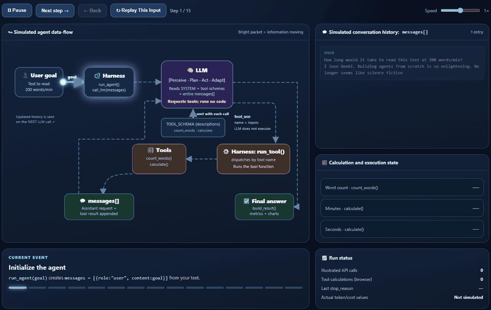
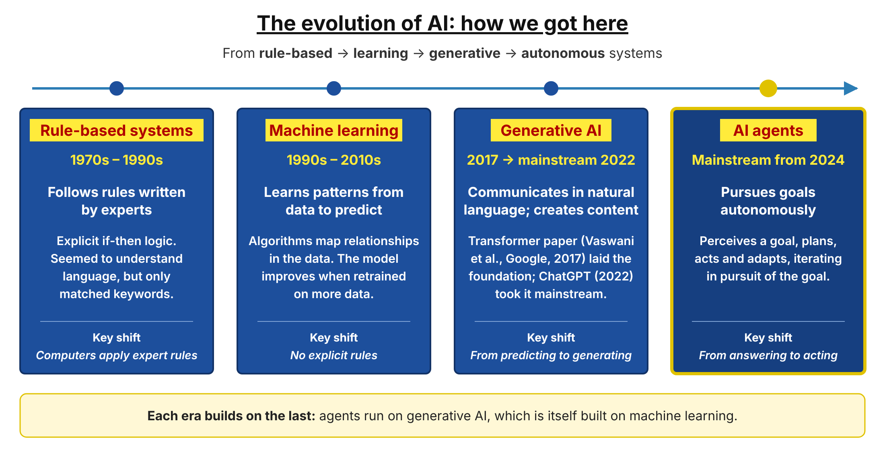
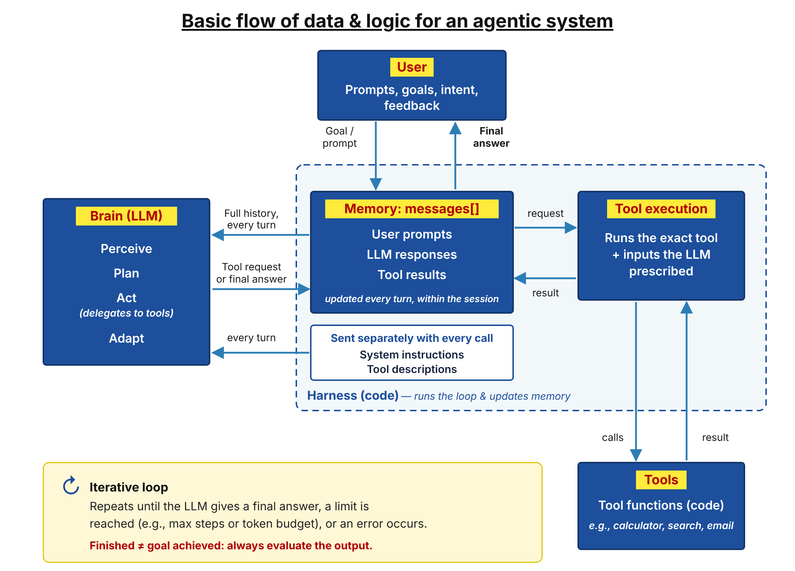

Click the image to view it full size → [Here](AI%20Agent%20Key%20Takeaways%20Infographic.png)

# Building an AI Agent from Scratch: Key Takeaways

## What's in this repo

| File | What it is |
|---|---|
| [AI Agent Key Takeaways Infographic](AI%20Agent%20Key%20Takeaways%20Infographic.png) | One-page visual summary of this write-up (shown at the top) |
| [▶ Interactive Simulation Demo](https://kishatmygh.github.io/ai-agent-from-scratch/basic_ai_agent_simulation_demo_INTUITIVE.html) | Animated, step-by-step simulation of the agent loop. Runs in your browser with no setup or API key. The model's choices are illustrated; the word count and reading-time maths run on your own text (preview below) |
| [Agent-TimeToRead.ipynb](Agent-TimeToRead.ipynb) | **The TimeToRead Agent:** takes a text and tells you how long it will take to read, based on the stated reading speed (e.g. 200 words per minute).  Built from scratch in Python, with a saved run, step-by-step trace and graphs. |
| [Agent_DataStructures_Reference.md](Agent_DataStructures_Reference.md) | **Recommended companion to the notebook.** Explains the Anthropic SDK classes and syntax behind the code |

➡️ **[Click here to try the Interactive Simulation Demo](https://kishatmygh.github.io/ai-agent-from-scratch/basic_ai_agent_simulation_demo_INTUITIVE.html)** (the image above is only a preview. The simulation doesn't call a real AI model; the notebook does.)

### Where to start

1. **Infographic (top of page):** the big picture on one page.
2. **Interactive Simulation Demo (above):** watch the agent loop run step by step. For a real run with Claude, see the notebook.
3. **Notebook + reference guide, together:** the notebook shows *what* the code does; the reference guide explains the Anthropic SDK syntax behind it, such as why `response.content` is a list of blocks and why `block.input` is a dict. **Strongly recommended if you're new to the Anthropic SDK:** it explains the syntax you'll need to reproduce the code yourself.
4. **The write-up below:** the concepts and lessons in more depth.

### How to run the notebook

1. **Install the packages** (Python 3.10 or later): `pip install -r requirements.txt`. This installs `anthropic`, `python-dotenv` and `matplotlib`.
2. **Add your API key:** get an Anthropic API key from the [Claude Console](https://console.anthropic.com), then create a file named `.env` next to the notebook containing `ANTHROPIC_API_KEY=your-key`. Never publish this file; this repo's `.gitignore` keeps it out.
3. **Run it:** open `Agent-TimeToRead.ipynb` in VS Code or Jupyter and run all cells.
4. **Check the result yourself:** compare the agent's answer with your own word count and calculation. A run that ends with status `finished` is not guaranteed to be correct.

The agent uses Claude Sonnet 5.5. A run like the saved one costs under one cent (about $0.009).

## Why build an agent from scratch?

Agent frameworks make it quick to build an agent, but they hide how it works. Building one from scratch, with only the Anthropic SDK, shows what really happens at each step: what is sent to the model, what comes back, and what the code does with it.

Why that matters:

- **You understand how it works, not just how to implement it.** You can explain why the agent behaves the way it does, not only which functions to call.
- **You can confidently assess what went wrong.** When an agent gives a wrong answer, loops, or costs more than expected, you know where to look: the system prompt, a tool's description, a tool's output, the conversation history or the stop condition.
- **You can put in safeguards for what could go wrong.** Knowing where an agent can fail lets you add checks before problems happen, not after.
- **You can assess vendor claims and set realistic expectations for agent projects.** Knowing what an agent actually does at each step makes it easier to judge what a tool or vendor can deliver, and at what cost.

When you later use a framework, you'll know what it is doing for you behind the scenes.

> **Note:** this task doesn't need an agent; a simple function could count the words and do the maths. It was chosen because it's small enough to see every step of the agent loop clearly.

## What you will learn

These are practical techniques and useful tips, not complete or fool-proof solutions. Agents used in production need stronger guardrails, monitoring and cost controls than this example shows.

- **How an AI agent works inside**
  - The loop: send the conversation to the model, run any tool it asks for, send the result back, and repeat until it gives a final answer.
  - How the code decides what happens next: `stop_reason` (`tool_use` means run the tools; `end_turn` means return the answer).
  - No agent framework: every step is plain, visible Python using only the Anthropic SDK.
- **How to give an agent tools**
  - Tools are ordinary Python functions with one rule in this code: a `dict` in, a `str` out.
  - The tool schema (name, description, inputs) is all the model sees when it chooses a tool, so it must be clear.
  - The model only *requests* a tool; the code runs it and sends the result back, matched by its `tool_use_id`.
- **How agent memory works**
  - The model is stateless, so the full conversation (`messages`) is resent on every call.
  - Each step adds the model's reply and the tool results to that list.
  - The system prompt and tool schema are sent alongside it on every call, not stored in it.
- **Simple ways to add transparency**
  - One way to see what the agent did: record every model call (why it stopped, which tool it chose, the inputs, the result and the tokens used).
  - When the model reasons, a summary of its thinking can be recorded too (a summary, not a word-for-word record).
  - A step-by-step trace printed after the run, with nothing printed inside the loop.
- **Basic token and cost tracking**
  - Read input and output tokens from every response and keep them per step.
  - Estimate cost per step and in total from the model's prices per million tokens.
  - Graph tokens per step and the running cost, to see how cost climbs as the conversation grows (the saved run: 4 calls, $0.009).
- **Basic guardrails: useful tips, not fool-proof**
  - Help reduce the risk of hallucination: use tools for counting and maths, and tell the model in the system prompt not to make up results.
  - Make tools safer: the calculator accepts only numbers and arithmetic, blocks powers (`**`) and limits length; tool errors go back to the model instead of crashing the agent.
  - Help contain token costs and runaway loops: a step limit (`max_steps`), an output limit per response (`max_tokens`), and a clear status for each main way a run can end.
- **How to read the SDK**
  - Class vs. object in this code: `Anthropic` → `client`, `Message` → `response`, `ToolUseBlock` → `block`.
  - Dots read SDK objects (`response.stop_reason`); square brackets read the lists and dicts you build (`TOOLS["calculate"]`).
  - The reference guide maps each SDK object to where the code uses it.

## 1. How we got here: the evolution of AI

- **In short** — AI has evolved from rule-based systems, to learning systems, to generative systems, and now to increasingly autonomous systems. Each era builds on the one before it rather than replacing it.
- **Rule-based systems (1970s–1990s)** — Largely before the internet reached most households. Experts hand-wrote explicit if-then rules. These systems had no real understanding of human language; they only appeared to, through keyword recognition.
- **Machine learning (1990s–2010s)** — Systems automatically learn patterns in data to make predictions. There are no explicit rules: the algorithms map the relationships in the data, and the model improves as it is retrained on more data. In my view, this was the first major breakthrough in realising the concept of artificial intelligence.
- **Generative AI (2017 foundation; mainstream from 2022)** — Heralded by the legendary Transformer paper, “Attention Is All You Need” (Ashish Vaswani et al., Google Brain and Google Research, 2017), which laid the foundation. ChatGPT (2022) took it mainstream. AI could now communicate in natural human language and generate new content, rather than only retrieving existing content or following pre-written scripts.
- **AI agents (mainstream from 2024)** — Autonomous systems that perceive a goal, plan, act and adapt, iterating in pursuit of that goal. The rest of this post explains how they work.

## 2. What is an agent?

- **An AI system, not an entity per se** — An agent is essentially an AI system with three defining features:
  - **(i) Autonomy: makes decisions independently** — Perceives the user's goal and its environment, then decides its own next steps toward achieving that goal. Note: autonomy may vary by design.
  - **(ii) Action: takes real-world action and gathers information through tools** — Tool use via tool selection and inputs. Software actions with deliberate, real consequences (e.g., sending emails, updating records, making payments), plus lookups that inform its next decision.
  - **(iii) Adaptation: adjusts based on results** — Adjusts its planning and decision-making based on feedback from its environment, such as tool results.
- **Today, the “brain” is an LLM** — This is what lets agents understand goals expressed in plain language, reason about them and explain their results. It is why anyone, not just engineers, can delegate work to an agent.
- **Why my definition doesn't mention LLMs** — I first came across the term “agent” in reinforcement learning, where an agent learns by acting in an environment and getting feedback. Today's LLM agents follow the same loop, with an LLM as the decision-maker. In future, the technology at the core may not be an LLM as we know it, so my definition deliberately avoids that limitation.

### Mental model: the Business Analyst (BA)

- **How a BA works** — The client communicates the problem. The BA perceives the client's goal or intent and plans the solution. The engineer does the implementation, but it is the BA who specifies what needs to be done. It may take multiple iterations until the project is finished, the budget runs out, or the project fails. Just like an AI agent, the BA must adapt with each iteration.
  - The client is not expected to say how to solve the problem (or achieve the goal); the BA, with the help of the engineer, works out the how.
- **How it maps to an agent**
  - **Client = User** — states the goal, not the how.
  - **BA = LLM** — works out the plan and decides the next step.
  - **Engineer = Tools & code** — carry out the execution.
  - **Iterations = The agent loop** — each pass builds on the last.
  - **Project finished, budget runs out, or project fails = Stop condition** — the agent stops when the LLM gives a final answer, a limit is reached (e.g., maximum steps or token budget), or an error stops it.

## 3. How is this implemented?

- **An iterative loop** — In the simplest terms, agents are systems where an LLM operates in an iterative loop, repeating until the LLM gives a final answer (it judges the task finished), a limit is reached (e.g., maximum steps or token budget), or an error stops it. The harness (the supportive environment around the LLM) enables it to:
  - **Update its context (memory)** — continuously accumulating user prompts, LLM responses and tool results: essentially a growing list that is fed back to the LLM every turn.
  - **Send the instructions and tool list** — on every call, the system prompt and tool descriptions are sent alongside `messages[]` as separate inputs. They are not stored in `messages[]`.
  - **Access tools** — functions (code) that either perform an action or retrieve information. Each tool must clearly define its name, what it can be used for, and the inputs it needs.
- **Finished does not mean successful** — When the agent stops, the goal has not necessarily been accomplished: the LLM may judge the task finished when it is not, or the loop may end on a limit or an error. That is why evaluating the output is so important.
- **The LLM decides; the code executes** — The LLM identifies the tool and provides the exact inputs, but it does not execute the tool itself.
  - **Analogy** — Like a CEO giving an exact instruction, not a goal: the LLM specifies precisely which tool to run and with what inputs, the code carries it out, and the LLM checks the result. Delegating this way is still acting.

## 4. Considerations when building agents

### Tools must be properly defined

- **The LLM only sees each tool's name, description and inputs** — That is all it has to choose with, so all three must be clear.
- **Otherwise** — The agent will not be able to make appropriate tool selections, resulting in an unattained goal or inefficient methods. Both can be financially costly via token usage.
  - **Note** — A token is a chunk of text, often part of a word (roughly ¾ of an English word on average). LLMs read and write in tokens, and API usage is typically billed per token.

### Memory is vital

- **LLMs are stateless** — The model does not remember anything after giving a response, not even earlier messages in the same conversation. Every LLM call starts from a blank slate.
- **Short-term memory (within a session)** — The harness keeps a running record of user prompts, LLM responses and tool results, and feeds it back to the LLM on every turn so it can keep track of what is going on. Once the session ends, it is gone unless it is saved separately (long-term memory).
- **It can't grow forever** — Once the record fills the model's context window, older content must be trimmed or summarised.
- **Key point: every call starts blank** — Memory is needed even within a single conversation. The harness re-sends the full history on every LLM call, so the agent always has the context it needs to continue the task.

### Agents, just like LLMs, can make mistakes

- **Today's agents run on LLMs** — So they can still make mistakes, e.g., hallucinate (make up information), choose the wrong tool, or take an unhelpful action.
- **We can mitigate this** — Through system prompts (instructions the LLM is asked to follow) and, more reliably, through controls built into the code: step limits, input validation, and human approval for high-impact actions (this agent uses the first two).
  - **System prompt used in the code** — *“You are a helpful assistant with access to tools. Use the tools for counting and calculating; do not make up results. If a tool you need is not available, say that you cannot help. Break the task into steps and work through them in order, waiting for each tool result before using it in the next step.”*

## Coming next: Agents in the real world

- **When should we use an agent,** and when is a simpler workflow the better choice?
- **How do we govern agents** that take real-world action?
- **What does it actually cost** to run one?
